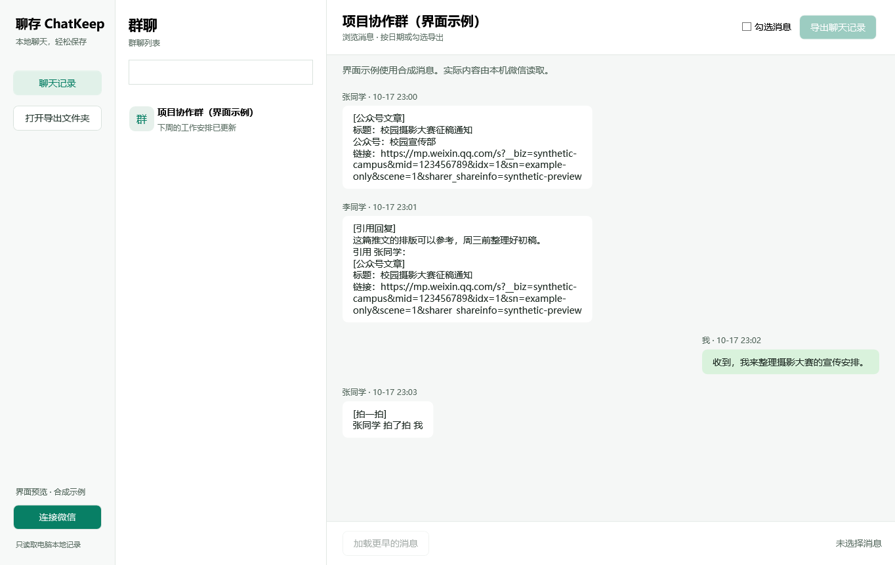

# 聊存 ChatKeep


本地聊天，轻松保存。面向 Windows 的微信本地群聊记录浏览与 HTML 导出工具。

[下载 Windows EXE](https://github.com/Jellyfish-Puff/ChatKeep/releases/latest) · [版本记录](https://github.com/Jellyfish-Puff/ChatKeep/releases)

v0.1.4 新增本地大图读取、微信特殊图片解码，以及大图缩放、适应窗口、100%和拖动查看；缩略图不再显示“查看大图”按钮，并修复数字表情引起的群聊闪退。保留公众号文章、引用回复及常见卡片识别，详情见 [版本说明](docs/releases/v0.1.4.md)。

## 使用

从 Release 下载 `ChatKeep.exe` 后双击即可，无需CMD、Python或.NET安装。可以将这个EXE单独复制到其他可写文件夹运行。自行打包的文件位于 `dist/ChatKeep.exe`。

点击“连接微信”，选择群聊。可以勾选消息，或直接点击“导出聊天记录”，选择日期、HTML 格式和保存位置。

结束日期包含当天全天。勾选导出同时应用日期条件。图片嵌入 HTML，文件可以单独保存；缺失或无法解码的本地资源保留说明，不会请求网络下载。语音、视频、表情暂以类型占位。

群聊中转发的公众号文章会读取本地卡片保存的标题、网址和公众号名称，已有摘要也会保留；普通网页链接保留本地标题与网址。标题缺失或网址失效时，仍保留可读取的信息，不联网补全。不会抓取公众号历史文章、正文或封面。

引用回复保留回复正文与可解析的被引用内容。HTML 导出为同一篇文章标注相同的文件内编号（如 A001），依据完整文章标识、相同短链接路径或完全相同的网址匹配；不会仅凭标题相同合并。无法证明相同的临时链接可能获得不同编号。直接粘贴的公众号网址也参与编号，但不会获取标题。

文件、红包、转账、拍一拍、小程序、视频号及合并聊天记录分别显示类型。文件只显示文件名，其他卡片保留可解析的文字提示，不展开附件或合并记录内容，不推断实时领取/交易状态。格式不支持或损坏时保留明确占位，不影响其他消息。消息文字和网址可选中复制，导出中的有效 HTTP/HTTPS 链接可手动点击。

本版仅展示群聊，支持搜索群名、加载更早消息。连接生成本地快照；需要更新记录时再次点击“连接微信”。不做后台自动同步。

## 独立EXE版本

Windows x64单文件版已包含.NET桌面运行时、Python解释器和读取依赖。首次连接时自动将内置读取组件解包到EXE旁的 `private/runtime`；数据缓存位于 `private/cache`，默认导出位于 `exports`。这些文件夹会在使用时自动创建，不需要从源码目录复制。

已验证：将EXE复制到无源码文件夹、移除Python PATH并指定无外部.NET目录后，仍能连接微信、读取消息与图片、导出 HTML。



界面示例使用合成消息。

## 源码开发依赖

- Windows 11，微信 4.1.15.13 登录运行。
- .NET 10 SDK。
- 64 位 Python 3.14，依赖见 `requirements.txt`。

源码开发版通过 Python 子进程读取数据；独立EXE使用内置读取组件。无需安装或启动 Wemory，无需重启微信。读取进程权限不足时可用管理员方式启动本应用。

## 数据存放

`private/cache` 是已解密数据库副本，`exports` 是默认导出目录，两者均不纳入版本管理。密钥仅存在于读取进程内存，关闭应用后释放，不写入日志或配置。应用不修改微信数据库或微信进程内存。

图片会比较当前消息关联的本地文件，选择可读取候选中像素最多的版本，而不是找到缩略图就停止。常见 JPEG/PNG/GIF/WebP 保留原始文件字节；可识别的微信 WXGF/HEVC 图片转换为原像素尺寸的 PNG，不缩小图片。复杂透明或动画内容暂仅保留静态首帧，会明确标注。

界面显示图片类型和实际像素尺寸；普通图片与本地大图提供“查看大图”，缩略图保留预览与说明。大图窗口默认适应窗口，支持滚轮、＋／－缩放、100%原始尺寸、拖动及滚动条查看细节。Ctrl＋0适应窗口，Ctrl＋1原始尺寸，Ctrl＋加／减号缩放，Esc关闭。缩放仅影响显示，导出保留原始像素。HTML 中点击图片可切换原始尺寸，支持滚动查看细节。图片只嵌入一次，仍为单文件 HTML，不需要联网或脚本。

本地仅找到缩略图时会保留并标注；存在其他候选但读取/解码失败时另作说明。应用不会联网下载缺失的原图。如果之后自行在微信中下载了大图，再次导出会重新检查关联目录，也可切换群聊重新加载预览。

## 构建与检查

```powershell
python -m pip install -r requirements.txt
dotnet build src/ChatArchive/ChatArchive.csproj -c Release
python -m unittest discover -s tests -v
```

独立版本的可复现打包步骤见 `docs/EXE打包.md`。

技术验证与当前限制见 `docs/开发与验证.md`，第三方算法参考与许可证见 `THIRD_PARTY_NOTICES.md`。

## 使用范围

当前版本以 Windows 11、微信 4.1.15.13 为验证环境，其他版本需要进一步适配。请仅处理自己拥有或已获授权的本地聊天数据。
